<div align="center">



<br/>

[](https://praveenkumarmsk.github.io/My_Profile_Portfolio/)
[](https://www.linkedin.com/in/praveen-kumar-msk/)
[](https://wa.me/916299078085)
[](mailto:krpravin406@gmail.com)


</div>

<br/>

## 🖥️ `Praveen# show profile`

```text
Name         : Praveen Kumar
Role         : Networking & IT Support Professional
Certified    : CCNA (Cisco) · ADCA
Experience   : 3.2 years · Physics Wallah · 6,000+ students managed
Focus        : Networking · IT Infrastructure · NOC · Desktop Support
Status       : up/up  (open to opportunities)
```

I'm an operations and technology professional with a passion for **networking and IT support**. I completed my **CCNA at Hubnet Patna** and I enjoy building labs, troubleshooting networks and creating small web tools.

<br/>

## 🛠️ `Praveen# show skills`

| Area | Skills |
|:--|:--|
| **Networking** |     |
| **IP Addressing** |     |
| **Routing** |    |
| **Switching** |     |
| **Services** |     |
| **Security** |     |
| **Desktop Support** |     |

<div align="center">


</div>

<br/>

## 🚀 `Praveen# show projects`

| Project | What it does |
|:--|:--|
| 🌐 [**My_Profile_Portfolio**](https://github.com/PraveenKumarmsk/My_Profile_Portfolio) | My portfolio website · [live](https://praveenkumarmsk.github.io/My_Profile_Portfolio/) |
| 🧭 [**network-planner-pro**](https://github.com/PraveenKumarmsk/network-planner-pro) | Network planning web tool |
| 🗓️ [**Time-Slot-Booking**](https://github.com/PraveenKumarmsk/Time-Slot-Booking) | Time slot booking web project |
| 🖼️ [**EasyImageFlex**](https://github.com/PraveenKumarmsk/EasyImageFlex) | Image web project |
| 🌱 [**Sakhaed**](https://github.com/PraveenKumarmsk/Sakhaed) | Web project built with HTML |
| 🔐 [**Encryption-Brute**](https://github.com/PraveenKumarmsk/Encryption-Brute) | JavaScript project |
| 🔀 [**VLAN Configuration Lab**](https://github.com/PraveenKumarmsk/VLAN-Configuration-Project-Labs) | VLANs, access/trunk ports, inter-VLAN routing |
| 📡 [**DHCP Configuration Lab**](https://github.com/PraveenKumarmsk/DHCP-Configuration-Project-Labs) | DHCP pools, gateway and DNS |
| 🔁 [**NAT & PAT Lab**](https://github.com/PraveenKumarmsk/NAT-PAT-Configuration-Project-Labs) | NAT/PAT for private-to-public communication |

<br/>

## 🏢 `Praveen# show experience`

**Physics Wallah Pvt. Ltd.** · 3.2 years

- **Batch Manager / Center Lead** — managed 6,000+ students, batch operations, schedules, escalations and academic workflows
- **Team Lead – Floor Operations** — daily floor operations, team coordination, classroom and infrastructure readiness
- **Team Lead – Class Operations** — live class / YouTube streaming support, technical support during classes, faculty coordination

<br/>

## 🎓 `Praveen# show certifications`

- **CCNA** — Cisco Certified Network Associate · Hubnet Patna
- **ADCA** — Advanced Diploma in Computer Applications · STS Computer Education

<br/>

## 📬 `Praveen# show contact`

| | |
|:--|:--|
| 🌐 Portfolio | [praveenkumarmsk.github.io/My_Profile_Portfolio](https://praveenkumarmsk.github.io/My_Profile_Portfolio/) |
| 💼 LinkedIn | [praveen-kumar-msk](https://www.linkedin.com/in/praveen-kumar-msk/) |
| 📧 Email | krpravin406@gmail.com |
| 💬 WhatsApp | [6299078085](https://wa.me/916299078085) |

<div align="center">


</div>
